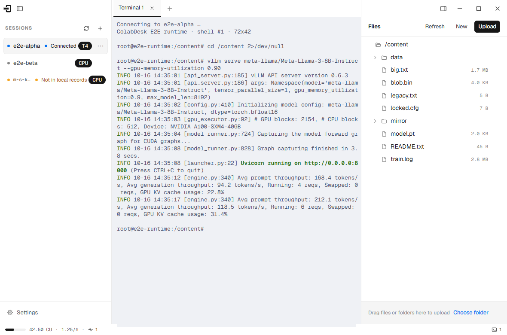
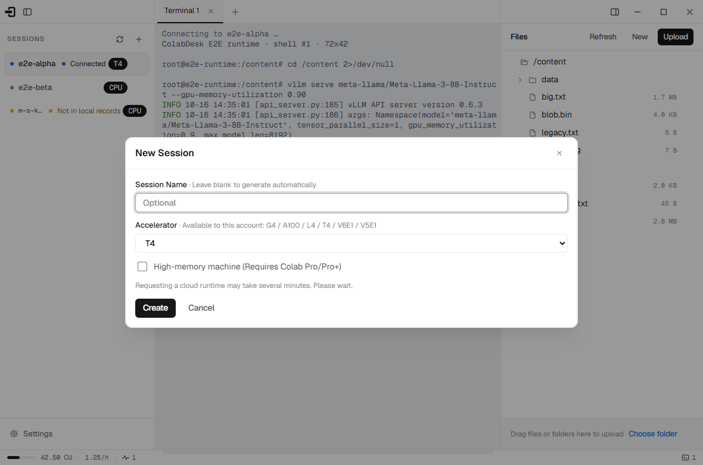
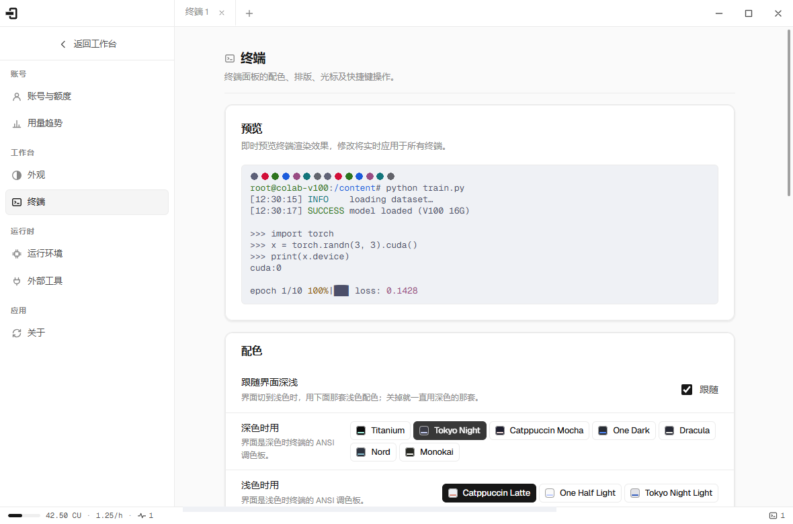
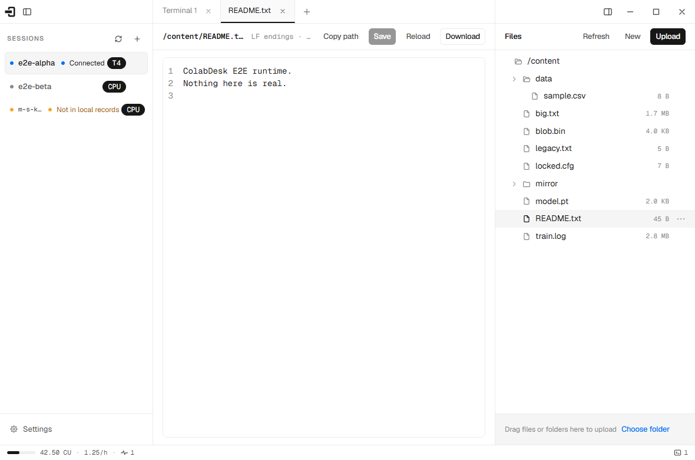
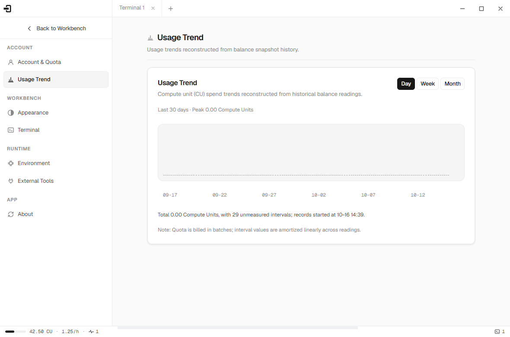
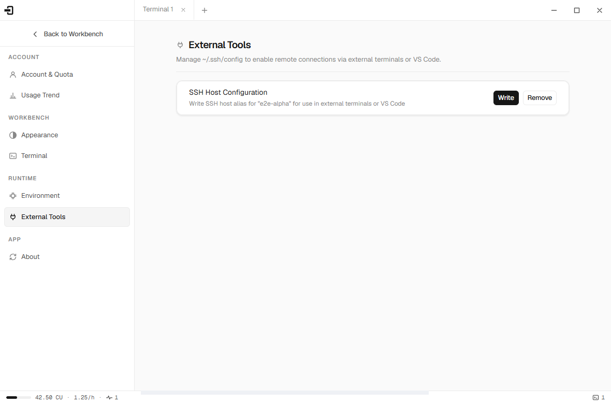
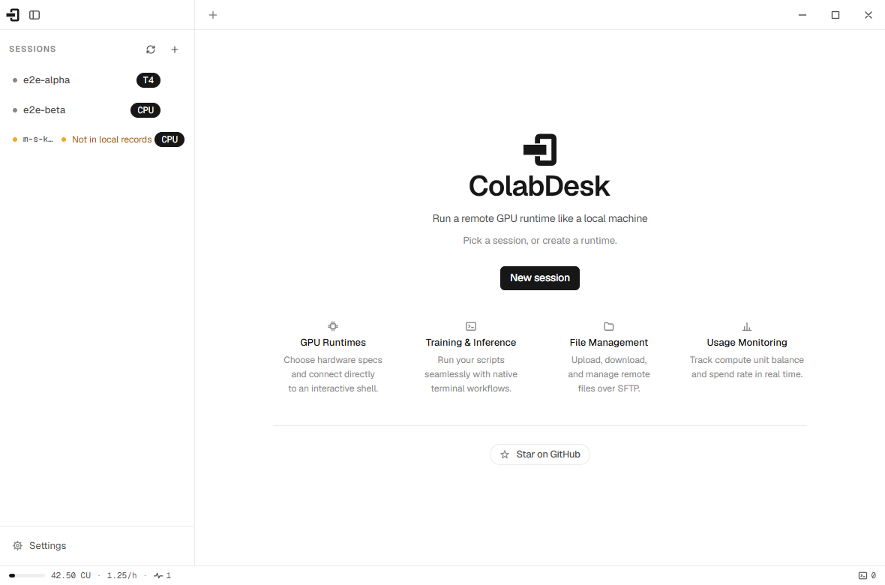
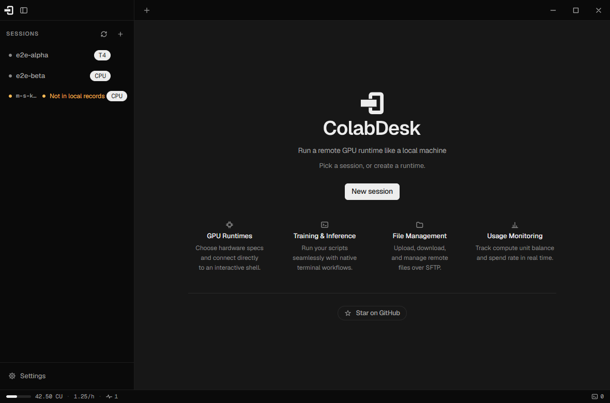
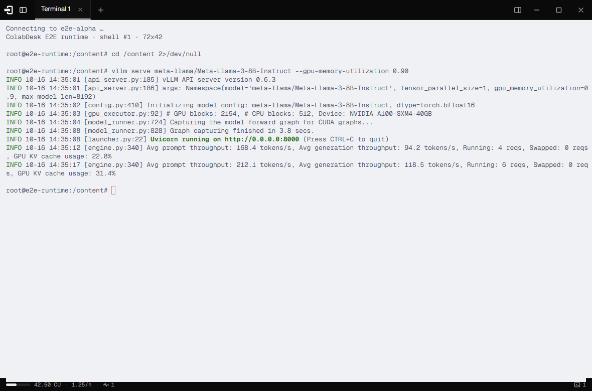
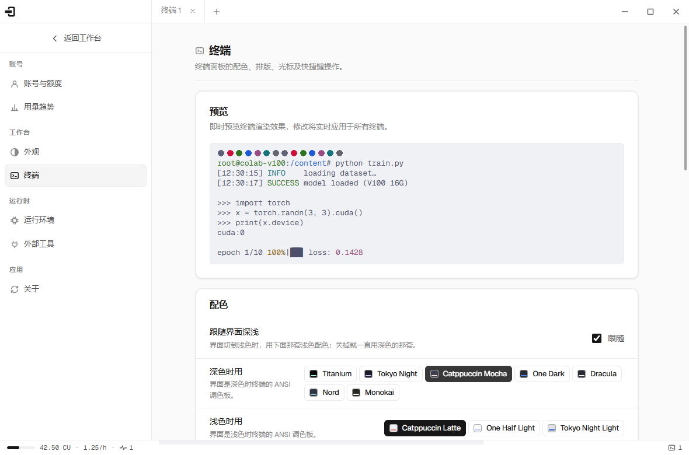

<div align="center">

<picture>
  <source media="(prefers-color-scheme: dark)" srcset="brand/final/variants/colabdesk-horizontal-white.svg">
  
</picture>

### The Unofficial Desktop Workstation for Google Colab

**Bring remote GPU runtimes to your fingertips like a local workstation.**

[](https://github.com/feifeifeimoon/ColabDesk/releases)
[](https://github.com/feifeifeimoon/ColabDesk/actions/workflows/ci.yml)
[](#download--installation)
[](LICENSE)
[](https://www.electronjs.org/)
[](https://react.dev/)

[English](README.md) • [简体中文](README_zh.md)

<br />

[](screenshots/01-workbench-light.png)

</div>

---

## Why ColabDesk?

Google Colab provides accessible, cost-effective GPU and TPU cloud runtimes, but web-based notebooks often fall short for serious software engineering and model training: browser tabs get disconnected, file operations are cumbersome, SSH configs expire constantly, and compute units drain invisibly.

**ColabDesk turns Google Colab into a local desktop experience:**

| Capability | Colab Web Notebook | Manual CLI / Custom Tunnel | **ColabDesk Desktop** |
| :--- | :--- | :--- | :--- |
| **Stability** | Sleep/tab suspension disconnects jobs | Fragile custom scripts | **Daemonized background SSH with auto-reconnect** |
| **Shell & Terminal** | Restricted web pseudo-terminal | Raw terminal without cloud context | **xterm.js multi-tab console with rich palettes** |
| **File Operations** | Slow single-file upload, no diffs | Manual `scp` / `rsync` commands | **Modern SFTP tree + CodeMirror 6 in-app editor** |
| **Compute Units (CCU)** | Buried inside deep settings menus | Requires manual balance CLI polling | **Live CCU balance, burn rate & historical trends** |
| **Local IDE Link** | Complex manual SSH tunneling | Frequent manual `~/.ssh/config` edits | **One-click config sync for VS Code, Cursor & PyCharm** |

---

## Core Features

| Feature | Key Capabilities | Interface Preview |
| :--- | :--- | :--- |
| **⚡ GPU Session Orchestration**<br>*Lifecycle & Hardware Management* | • **One-Click Provisioning**: Launch, attach, and terminate GPU/TPU instances instantly.<br>• **Hardware Eligibility Matrix**: Auto-detects account permissions (T4, V100, A100, L4, H100, High-RAM).<br>• **Untracked Session Adoption**: Automatically discovers and attaches to existing cloud backends. | [](screenshots/04-new-session-light.png) |
| **💻 Modern Integrated Terminal**<br>*High-Performance Multi-Tab Shell* | • **Multi-Tab Concurrency**: Independent terminal sessions powered by zero-lag `xterm.js`.<br>• **Curated Color Themes**: Tokyo Night, Catppuccin, Dracula, Nord, Monokai, One Dark, etc.<br>• **External Terminal Pass-Through**: One-click launch into Windows Terminal or macOS Terminal. | [](screenshots/05-terminal-tokyo-night-light.png) |
| **📁 Remote SFTP & In-App Editor**<br>*File Tree, Transfer & Fast Editing* | • **Visual File Tree**: Drag-and-drop batch upload/download with transfer queues and conflict policies.<br>• **Built-in CodeMirror 6**: View and edit remote code and configs without local synchronization.<br>• **Safety Guards**: Dual-end truncation protection for large logs, and remote conflict detection. | [](screenshots/08-file-tab-light.png) |
| **📊 Quota & Usage Trends**<br>*Real-time CCU & Cost Analytics* | • **Real-time Quota**: Live Compute Units (CCU) balance and instant consumption rate.<br>• **Historical Trends**: Granular daily, weekly, and monthly consumption charts.<br>• **Threshold Alerts**: Avoid surprise disconnections caused by exhausted compute credits. | [](screenshots/06-settings-usage-light.png) |
| **🔌 One-Click External IDE Bridge**<br>*Native VS Code & Cursor Integration* | • **Automated `~/.ssh/config`**: Effortless host aliases and authentication key injection.<br>• **Seamless IDE Connect**: One-click connect via **VS Code (Remote-SSH)**, **Cursor**, or **PyCharm**.<br>• **Tunneling Workflow**: Ready for remote Jupyter, TensorBoard, and web applications. | [](screenshots/06-settings-external-light.png) |

---

## Design & Appearance

ColabDesk follows a disciplined, restrained engineering design system (documented in [`docs/DESIGN.md`](docs/DESIGN.md)). The shell stays clean and unobtrusive, allowing your code and terminal output to take center stage.

| Light Mode (Clean Precision) | Dark Mode (Focus & Depth) |
| :---: | :---: |
| [](screenshots/00-start-page-light.png) | [](screenshots/00-start-page-dark.png) |

| Focus Mode (Distraction-Free Terminal) | Multi-Theme Terminal Engine |
| :---: | :---: |
| [](screenshots/02-focus-dark.png) | [](screenshots/05-terminal-catppuccin-mocha-light.png) |

---

## Quick Start

### 1. Download & Launch
Download the installer or binary for your operating system from [Releases](https://github.com/feifeifeimoon/ColabDesk/releases).

### 2. Connect Your Google Account
1. Launch ColabDesk and click **Sign in with Google**.
2. Complete the OAuth verification in your default browser.
3. ColabDesk securely receives and encrypts your credentials locally to inspect your available hardware and compute units.

### 3. Provision a GPU and Start Hacking
1. Click **New Session**, select your preferred accelerator (e.g. `NVIDIA A100`, `L4`, or `T4`), and choose standard or high-RAM shape.
2. The interactive terminal connects automatically within seconds.
3. Explore remote files directly from the sidebar, or click **Open in VS Code** to connect your favorite local IDE immediately.

---

## Download & Installation

ColabDesk provides prebuilt binaries for **Windows** and **macOS**:

| Platform | Architecture | Installer Type | Notes |
| :--- | :--- | :--- | :--- |
| **Windows** | x64 (64-bit) | `.exe` (NSIS Installer / Portable) | Requires Windows 10/11 |
| **macOS** | Apple Silicon (`arm64`) | `.dmg` | Native M1 / M2 / M3 / M4 support |
| **macOS** | Intel (`x64`) | `.dmg` | Compatible with macOS 12+ (Monterey or later) |

> Auto-updates are powered by `electron-updater`, seamlessly notifying you whenever a new release is available.

---

## Architecture & Tech Stack

ColabDesk is engineered for performance, cross-platform consistency, and absolute user safety:

- **Runtime & Desktop Shell**: [Electron](https://www.electronjs.org/) + [electron-vite](https://electron-vite.org/)
- **UI Framework**: [React 19](https://react.dev/) + [Zustand](https://github.com/pmndrs/zustand)
- **Terminal Engine**: [xterm.js](https://xtermjs.org/) with Fit, Search, Unicode 11, and WebLinks addons
- **Code & Text Preview**: [CodeMirror 6](https://codemirror.net/) with syntax highlighting and truncation guards
- **Remote Protocol**: Native [ssh2](https://github.com/mscdex/ssh2) & SFTP stream client with concurrent throttled pipes
- **Type Safety & Linting**: TypeScript + [Oxlint](https://oxc.rs/docs/guide/usage/linter.html) + [Vitest](https://vitest.dev/) + [Playwright](https://playwright.dev/)

---

## Development & Contributing

We welcome contributions from the community! To run and build ColabDesk locally:

### Prerequisites
- Node.js >= 20.0.0
- npm >= 10.0.0

### Setup Workflow
```bash
# 1. Clone the repository
git clone https://github.com/feifeifeimoon/ColabDesk.git
cd colabdesk-electron

# 2. Install dependencies
npm install

# 3. Start the application in development mode
npm run dev

# 4. Code quality & verification
npm run typecheck    # TypeScript compiler check
npm run lint         # Oxlint correctness validation
npm test             # Vitest unit and static render assertions
npm run e2e          # Playwright end-to-end test suite
```

> **Testing without Google credentials?**  
> ColabDesk includes a built-in mock runtime double under `src/main/e2e/`. Running `npm run e2e` automatically spawns an isolated local SSH and WebSocket backend without requiring any cloud accounts or real compute units.

---

## FAQ

<details>
<summary><b>Do I need a Colab Pro or Pro+ subscription to use ColabDesk?</b></summary>
<br>
No. Free Google Colab accounts work out of the box with standard CPU and T4 GPU allocations. If you have Colab Pro or Pro+, ColabDesk will automatically detect your eligible premium accelerators (V100, A100, L4, TPU) and high-memory shapes.
</details>

<details>
<summary><b>Are my Google credentials and tokens secure?</b></summary>
<br>
Yes. ColabDesk runs 100% locally on your machine. Authentication tokens are communicated directly between your machine and Google's official endpoints. There are no intermediary cloud proxy servers or third-party analytical telemetry tracking your data.
</details>

<details>
<summary><b>What happens if my network disconnects during a training run?</b></summary>
<br>
Your Google Colab instance runs independently in the cloud. Even if your local network drops or you restart your laptop, ColabDesk will automatically re-attach to your existing session upon reopening, restoring the terminal and file views.
</details>

---

## Disclaimer

**ColabDesk is an independent, open-source project and is NOT affiliated with, sponsored by, or endorsed by Google LLC.**  
*Google Colab* and the *Google* brand are trademarks of Google LLC. Please ensure your usage complies with the [Google Colab Terms of Service](https://research.google.com/colaboratory/faq.html).

---

## License

This project is licensed under the [Apache License 2.0](LICENSE).